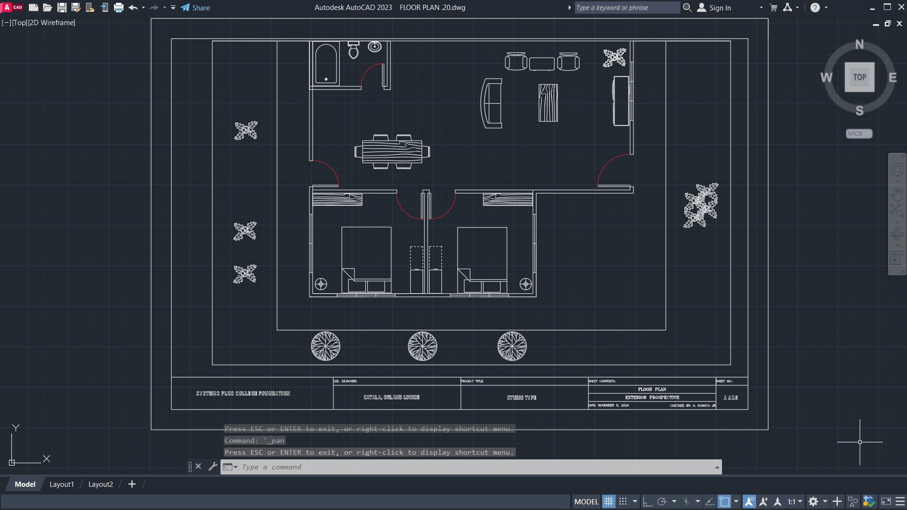

# Floor Plan 20



## Overview

This repository contains the architectural floor plan for the project. The original drawing is provided as an AutoCAD DWG file, and a rendered preview is included as `floorplan.jpg`.

## Files

| File | Description |
| --- | --- |
| `FLOOR_PLAN__20.dwg` | Original AutoCAD drawing |
| `floorplan.jpg` | Image preview of the floor plan |
| `README.md` | Project documentation |

## Viewing the Floor Plan

1. Open `floorplan.jpg` for a quick preview.
2. For full detail and editing, open `FLOOR_PLAN__20.dwg` in AutoCAD, DWG TrueView, or any DWG-compatible viewer.

## Requirements

- AutoCAD 2018 or later (recommended)
- DWG TrueView (free viewer from Autodesk)

## Project Structure

```
.
├── FLOOR_PLAN__20.dwg
├── floorplan.jpg
└── README.md
```

## Notes

- Dimensions and layout are subject to revision.
- Make sure `floorplan.jpg` sits in the same folder as `README.md` so the image displays correctly.

## Author

Orland Louise Catala
